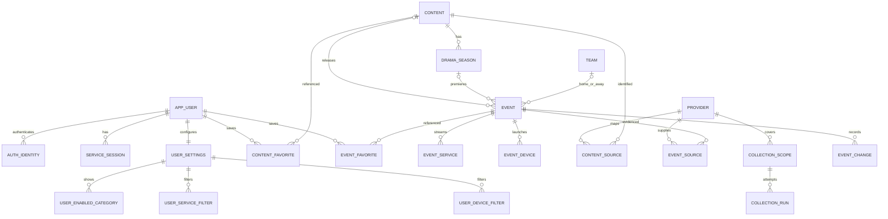

# DB 관계·불변 조건 초안

버전 `0.1.0-draft.1`. [DDL](database.sql)은 migration이 아닌 검토용 참조다. PostgreSQL에 실행하지 않았다.
Prisma를 ORM으로 사용하되 버전 고정 전 임의의 generator/datasource 설정이나 생성 코드를 넣지 않는다.
구현할 때 이 관계를 Prisma 모델로 옮기고 Prisma Schema가 표현하지 못하는 CHECK/부분 인덱스는 migration SQL에 보존한다.

## DB에서 강제하는 조건

| 대상 | DB 제약 |
|---|---|
| 계정 식별 | provider=google, provider+subject UNIQUE, user FK |
| 설정/찜 | 사용자/대상 FK, 복합 PK로 중복 방지, settings.version/favorites_version 양수 |
| 작품/시즌 | 시즌은 drama만 참조, 작품별 시즌 번호 UNIQUE, 시즌과 이벤트 content_id 일치 복합 FK |
| 이벤트 종류 | 극장=movie, OTT=drama, 게임=game, EPL=작품 없음+다른 홈/원정 팀 |
| 시간 | instant/date_only/unknown 상호 배타 CHECK. nullable 필드 비교는 IS NOT NULL을 포함해 UNKNOWN 통과 방지 |
| 플랫폼/기기 | event_service는 OTT만, event_device는 게임만 연결. 복합 FK+enum+복합 PK |
| 출처 매핑 | provider+외부 ID+안정 variant key UNIQUE. variant에 날짜를 넣지 않아 연기 시 ID 유지 |
| 계정 삭제 영향 | 개인 관계/세션/설정 CASCADE. 콘텐츠/일정은 공유 데이터이며 사용자 삭제로 지우지 않음 |
| 카탈로그 삭제 영향 | 참조 있는 Content/Event 삭제는 FK로 제한. 연기/취소는 UPDATE와 history |

## 트랜잭션/도메인에서 보장할 조건

CHECK에서 다른 행/테이블의 개수를 검사하지 않는다. 다음 조건을 DB가 이미 보장한다고 주장하지 않는다.

- 신규 user 생성과 identity·settings·movie/ott 초기 분야는 한 트랜잭션. 기존 계정에 기본값 덮어쓰기 금지.
- 설정 교체는 version을 조건으로 부모·관계 행을 원자적으로 갱신한다. 국가/시간대는 실제 지원 집합으로 검증.
- OTT에는 service 최소 하나, 게임에는 device 최소 하나. 공개 전 도메인 검사와 원자적 카탈로그 publish로 보장한다.
- 실데이터 Event는 최소 한 출처 근거를 가지며 provider.origin과 event.origin이 일치한다. fixture의 출처/원본을 실데이터로 위장하지 않는다.
- canonical Event는 지원 범위의 시즌 최초 공개/정식 출시/극장 개봉/EPL만 허용한다. 회차 이벤트 테이블은 만들지 않는다.
- 시즌이 알려지면 해당 Season 참조, 미상이면 null. 출처 정정으로 동일 이벤트가 식별되면 안정 ID/찜 관계 보존 절차가 필요하다.
- 공개 데이터/출처/최신성 변경과 catalog_state.revision 증가, event_change 기록은 같은 publish 트랜잭션이다.
- failed 수집은 last_attempt만 갱신하고 마지막 성공 데이터/시각을 지우지 않는다. 수집 상태 변경도 revision에 반영한다.
- 개인 찜 관계 변경과 favorites_version 증가를 같은 사용자 행 잠금/트랜잭션으로 묶는다. 무변경 재시도는 증가하지 않음.
- 이전 시각은 event_change의 canonical time에서 가져와 현재 응답 시간대로 표현한다. 화면용 displayDate를 DB 원본으로 저장하지 않는다.

## 저장하지 않는 것과 변경 여지

Google ID token·서비스 세션 원문·제공처 비밀을 DB 근거/변경 JSON에 저장하지 않는다. 세션 원문은 발급 응답 후 앱 Keychain에서 관리한다.
DDL은 최소 식별/정합성 중심이다. provider별 team 매핑·중복 후보 검토·보관/아카이브·성능 인덱스 추가는 실제 데이터·조회 계획 근거로 후속 설계한다.
시간대 필터에 UTC timestamp와 지역 date를 한 컬럼으로 통일하지 않는다. 복수 서비스/기기 join으로 행이 늘어도 DISTINCT Event 기준으로 집계한다.

## 구조 선택의 이유

하나의 target_type/target_id 찜 테이블보다 두 명시적 FK 관계가 대상 무결성을 단순하게 보장한다.
작품과 공개 이벤트 분리는 시즌/지역/기기별 날짜 차이와 날짜 변경을 같은 모델에서 표현한다.
전역 revision은 과거 snapshot 보관 없이 일관된 재조회를 가능하게 한다. 범위/성능/갱신 빈도가 바뀌면 다시 판단한다.
이는 예방 설계이며 실제 운영 장애 해결이나 성능 개선 측정 사례가 아니다.
